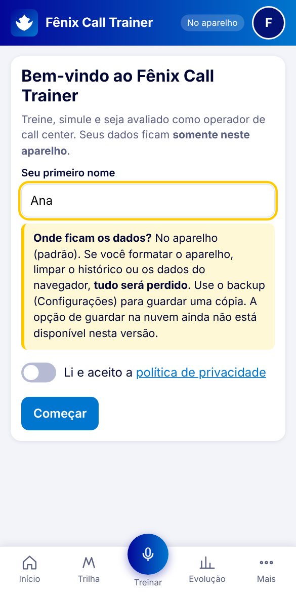

# Fênix Call Trainer — Manual do usuário (v1.0)

## Primeiro acesso

- Informe o seu primeiro nome e aceite a política de privacidade.
- Os dados ficam só neste aparelho. Formatar o aparelho ou limpar os dados do navegador apaga tudo: use Configurações → Exportar backup.

## Diagnóstico

- Início → Fazer o diagnóstico: 6 perguntas rápidas.
- O resultado indica por quais módulos da trilha começar.

## Trilha de aprendizagem

- Abra o módulo: leia a mini-aula, veja o exemplo bom e o ruim, responda o exercício e simule.
- Módulo dominado = 3 simulações seguidas com nota igual ou acima do corte e sem falha crítica (configurável).
- Quando dominar os 10 módulos, o botão de certificado em PDF aparece.

## Treinar (4 modos)

- **Leitura guiada:** leia o script em voz alta e toque em "próxima" a cada linha; mede ritmo, pausas e volume.
- **Simulação por texto:** escreva o que diria ao cliente virtual.
- **Simulação por voz:** fale pelo microfone; o cliente responde por voz. Precisa de Chrome ou Edge; sem suporte, o app usa texto.
- **Sem consulta:** o script fica oculto.
- Pausar, Reiniciar e Finalizar ficam no topo da simulação.

## Relatório

- Nota de 0 a 100, desempenho por bloco, pontos fortes e no máximo 3 prioridades, com trecho da conversa e "como dizer melhor".
- Falha crítica (promessa indevida, desrespeito, dado pessoal exposto, expressão proibida, falta de confirmação de identidade quando exigida) reprova a tentativa.
- O selo "Demonstração" indica que a avaliação foi feita por regras do app, sem IA externa.

## Laboratório de voz e Espelho de voz

- Calibre a sua voz lendo o texto de referência: o app aprende o seu ritmo normal.
- Espelho de voz (liga e desliga): medidores de velocidade, volume, tom e pausas com a sua zona confortável. Só você vê.
- O app nunca diz como você se sente. A pergunta "Como você se sentiu?" é opcional, privada e não entra em nota.
- O volume é relativo ao microfone: recalibre ao trocar de fone.

## Scripts e cenários (Instrutor)

- Menu do avatar → mudar para Instrutor.
- Scripts: crie, edite, duplique, arquive, exporte e importe (JSON). Cada etapa tem expressões esperadas que a avaliação confere por código.
- Cenários: escolha script, perfil de cliente e dificuldade (1 a 4).

## Testes e seleção (Instrutor)

- Crie o teste (cenário, tempo, corte, tentativas, script oculto, Espelho permitido ou bloqueado: igual para todos).
- Aplique ao candidato: ele informa o nome, lê o aviso e aceita; pode responder por texto sem prejuízo.
- Revise as evidências e registre a decisão: a decisão final é humana. Métricas de voz não aparecem para o instrutor.

## Backup e exclusão

- Configurações → Exportar backup / Importar backup (substitui os dados atuais, pede a palavra IMPORTAR).
- Excluir minha conta e meus dados pede a palavra APAGAR.

## IA externa (opcional)

- Configurações → IA externa: informe o endereço HTTPS de uma função segura sua. Chaves de API nunca ficam no app.
- Se a IA falhar, o app volta sozinho ao modo Demonstração e avisa.

